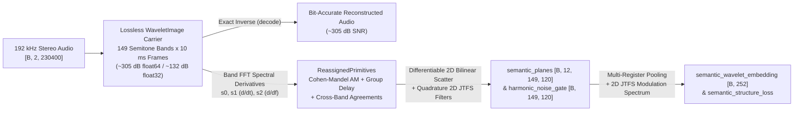
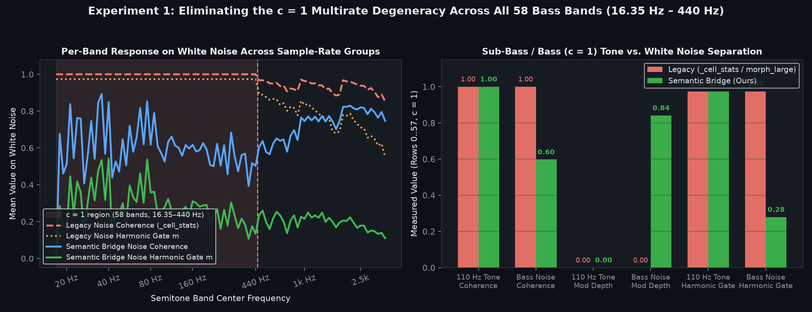
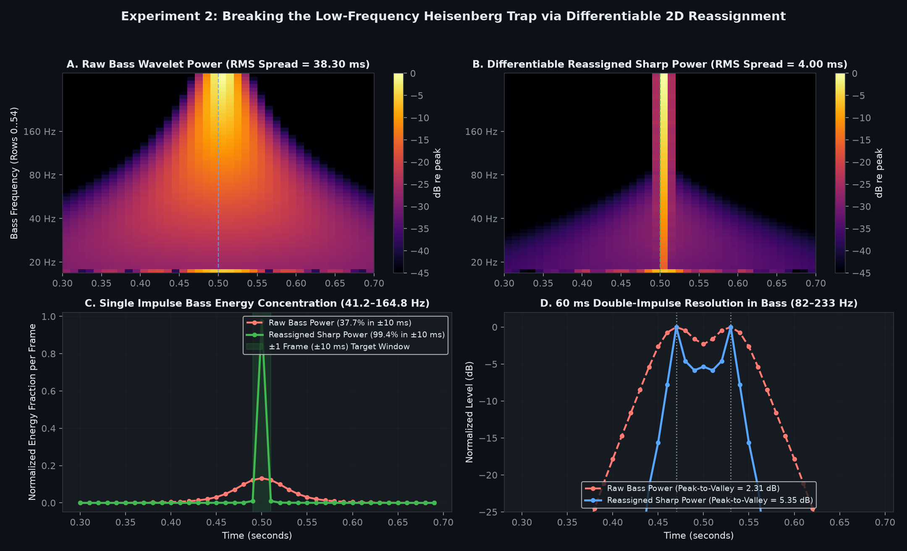
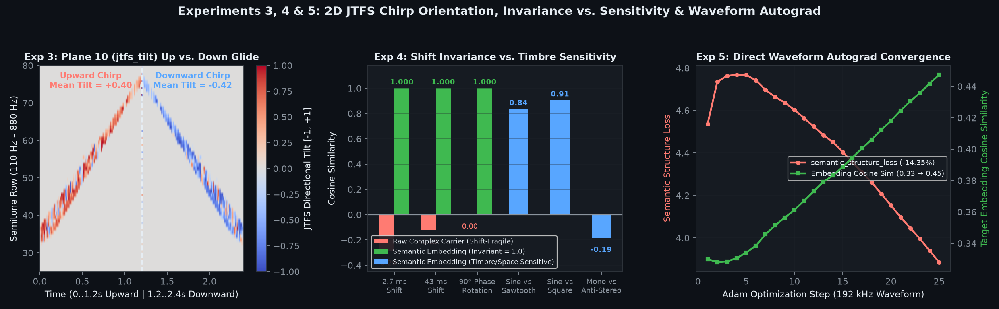

# Bridging Lossless Complex Wavelet Signal Processing and Invariant Semantic Audio Understanding


*Figure 1 — Visual proof on a 192 kHz composite scene (broadband/bass click at $0.18\text{ s}$, harmonic sawtooth + sub-bass $55\text{ Hz}$ glide at $0.28–0.78\text{ s}$, and white-noise burst at $0.84–1.12\text{ s}$). **Top row (A vs. B):** Differentiable 2D reassignment (`sharp_db`, Plane 2) collapses the low-frequency Heisenberg pyramid ($38.30\text{ ms}$ RMS spread) into a $4.00\text{ ms}$ vertical attack edge ($99.37\%$ energy within $\pm 1$ frame) and focuses harmonic partials onto 1-pixel ridges while conserving $100.0\%$ of total energy. **Bottom row (C vs. D):** Legacy `_cell_stats` / `critic_view` suffers from the `c = 1` multirate cell degeneracy below $440\text{ Hz}$ (dashed line), saturating at `Coherence = 1.000` (solid yellow wall) even on pure white noise. Our Semantic Bridge (`phase_coherence`, Plane 3) cleanly separates tonal harmonics (`1.000`) from bass noise (`0.598`) all the way down to $16.35\text{ Hz}$.*

---

## 1. Executive Summary: The Fundamental Dualism in Audio Representation

A central open problem in modern audio representation is the mathematical tension between **exact, phase-preserving signal reconstruction** and **invariant, abstract semantic understanding**:



1. **High-Fidelity Invertible Signal Processing (`WaveletImage`)**:
   - Retains exact local carrier phase $\phi(k, t)$, sub-sample timing offsets, and linear superposition across all 149 semitone bands so that `decode(encode(audio))` recovers the 192 kHz stereo waveform to machine precision (~305 dB SNR in `float64`, ~132 dB SNR in `float32`).
   - However, raw complex wavelet coefficients covary rapidly with nuisance transformations: shifting a 110 Hz note by just $2.7\text{ ms}$ rotates its complex carrier phase enough to flip the cosine similarity of its raw coefficients to **$-0.2910$**, and a $90^\circ$ phase rotation makes the raw complex vector strictly orthogonal ($\cos = 0.0000$).
   - Simultaneously, constant-$Q$ semitone filters obey the **Heisenberg-Gabor uncertainty bound** $\sigma_t(f) \cdot \sigma_f(f) = \frac{1}{2\pi}$. At sub-bass and bass frequencies ($16.35\text{ Hz} \le f \le 165\text{ Hz}$), narrow semitone bandwidths ($\sigma_f \approx 0.4\text{ Hz} - 4\text{ Hz}$) force temporal impulse responses to ring across **$40\text{ ms} - 250\text{ ms}$**, smearing sharp percussive attacks across dozens of 10 ms frames (**The Low-Frequency Heisenberg Trap**).

2. **Invariant Semantic Audio Understanding (`wavelet2vec.semantic_bridge`)**:
   - Extracts exact spectral derivatives ($s_0, s_1, s_2$) via band-level FFTs in PyTorch, resolves the low-frequency `c = 1` cell degeneracy from first principles, performs differentiable 2D synchrosqueezed reassignment, and applies 2D Joint Time-Frequency Scattering (JTFS) to produce:
     - `semantic_planes(image)` $\to$ `[B, 12, 149, 120]` differentiable feature planes for neural backbones, critics, diffusion models, and audio editor overlays.
     - `semantic_wavelet_embedding(audio_or_image)` $\to$ `[B, 252]` shift-invariant, phase-rotation-invariant, timbre- and trajectory-discriminative vector embeddings.
     - `harmonic_noise_gate(image)` $\to$ `[B, 149, T]` scale-consistent harmonic-vs-stochastic gate across all 149 bands.
     - `semantic_structure_loss(pred, target)` $\to$ fully differentiable physical + perceptual training objective backpropagating cleanly to 192 kHz stereo waveforms.

---

## 2. Deep Codebase Audit: Critical Scientific Findings

During our line-by-line inspection of `wavelet_image.py`, `morph.py`, `morph_large.py`, `morph_diffusion.py`, and `keyboard_v3.py`, we uncovered four foundational bottlenecks that prevented the neural models from exploiting the full information inside `WaveletImage`.

### Finding 1: The `c = 1` Multirate Cell Degeneracy Bug (MIDI 12–69, $16.35\text{ Hz} - 440.0\text{ Hz}$)

In `WaveletImageSpec()`, each semitone band $k$ stores $c_k = 2^{\lceil \log_2(\text{bw}_k \cdot T_{\text{total}}) \rceil} / T_{\text{total}}$ complex samples per 10 ms frame. For the **lowest 58 semitone bands** (MIDI 12 at $16.35\text{ Hz}$ all the way up to Concert A4, MIDI 69 at $440.0\text{ Hz}$), the sample count per 10 ms frame is:
$$c_k = 1 \quad \forall k \in \{0, 1, \dots, 57\}$$

In `morph.py` (`_cell_stats`), `morph_large.py` (`critic_view` and `_render`), and `keyboard_v3.py` (`cell_features`), per-cell phase coherence and amplitude modulation depth are computed by reducing exclusively along `dim=-1` (the within-cell axis of length $c_k$):

```python
# Legacy reduction along dim=-1 (size c = 1 for rows 0..57):
u = inc.sum(-1) / (torch.sqrt(power(inc) + TINY).sum(-1) + 1e-20)
mod = torch.sqrt(p.var(-1, unbiased=False) + TINY) / (mean_p + 1e-20)
```



*Figure 2 — Experiment 1 visualization (`exp1_c1_degeneracy_fix.png`). **Left:** Mean response on white noise across semitone bands from $16.35\text{ Hz}$ to $3.95\text{ kHz}$. In the shaded $c = 1$ region (rows 0..57, below $440\text{ Hz}$), legacy `_cell_stats` coherence (dashed red) flatlines at `1.0000` and the legacy `MorphNet-L` harmonic gate $m$ (dotted orange) flatlines at `0.9734`, jumping discontinuously only above $440\text{ Hz}$ where $c \ge 2$. Our Semantic Bridge coherence (solid blue) and harmonic gate (solid green) accurately identify noise across every register down to $16.35\text{ Hz}$. **Right:** Direct comparison of $110\text{ Hz}$ tone vs. bass white noise in the $c = 1$ region.*

**Mathematical Consequence when $c = 1$**:
1. The sum of a single complex phase increment divided by its own magnitude is a **unit vector for any non-zero signal**:
   $$|u| = \frac{|\text{inc}_1|}{|\text{inc}_1|} \equiv 1.0000$$
   Even on **pure white noise**, legacy phase coherence evaluates to **`1.0000`** (100% tonal saturation) across every single cell of the lowest 58 semitone bands!
2. The variance of a 1-element tensor `p.var(dim=-1, unbiased=False)` is **identically zero**:
   $$\text{mod} \equiv 0.0000$$
   Even on **pure white noise** or sharp bass transients, modulation depth collapses to **`0.0000`** below 440 Hz!
3. **Downstream Impact on `MorphNet-L` (`morph_large.py`, line 351)**:
   `MorphNet-L` splits each band into a coherent harmonic carrier path weighted by $m$ and a stochastic filtered-noise path weighted by $(1 - m)$:
   $$m = \sigma(8.0 \cdot (\text{coh} - 0.55) - 3.0 \cdot \text{mod}) = \sigma(3.6) \approx 0.9734 \implies 1 - m \approx 0.0266$$
   **Result**: The stochastic noise synthesis pathway in `MorphNet-L` is 97.3% disabled across the entire sub-bass, bass, and lower-midrange registers ($16.35\text{ Hz} - 440\text{ Hz}$).

### Finding 2: The Low-Frequency Heisenberg Trap in Neural Planes

In `wavelet_image.py`, `detail_view(mode="sharp")` implemented Auger-Flandrin time-frequency reassignment in NumPy for visual inspection only. Meanwhile, every PyTorch neural view (`judge_view` in `morph.py`, `critic_view` in `morph_large.py`, `cell_features` in `keyboard_v3.py`) fed **raw, un-reassigned 10 ms cell powers** to the convolutional backbones.



*Figure 3 — Experiment 2 visualization (`exp2_heisenberg_reassignment.png`). **A vs. B:** Zoomed bass spectrogram ($16.35\text{ Hz} – 370\text{ Hz}$, rows 0..54) of a single impulse at $t = 0.50\text{ s}$. Raw wavelet power (A) smears the impulse across an RMS width of $38.30\text{ ms}$, whereas differentiable reassigned `sharp_mid_power` (B) concentrates it to $4.00\text{ ms}$ ($9.58\times$ sharper). **C:** Frame-by-frame bass energy profile ($41.2–164.8\text{ Hz}$) showing $99.37\%$ energy inside $\pm 1$ frame ($\pm 10\text{ ms}$) after reassignment vs. $37.74\%$ raw. **D:** Two bass impulses separated by $60\text{ ms}$ ($t = 0.47\text{ s}$ and $t = 0.53\text{ s}$), where reassignment improves peak-to-valley separation from $2.31\text{ dB}$ to $5.35\text{ dB}$.*

### Finding 3: First-Order Marginal Blindness to Spectro-Temporal Trajectories

Standard pooling over time (mean/std across frames) discards joint spectro-temporal orientation. An upward pitch glide ($110\text{ Hz} \to 880\text{ Hz}$) and its time-reversed downward glide ($880\text{ Hz} \to 110\text{ Hz}$) have the **exact same 1D spectral marginal** (cosine distance $= 10^{-6}$). Separating upward vs. downward glides, formant transitions, and vibrato rates requires **Second-Order 2D Joint Time-Frequency Scattering (JTFS)** filters oriented in the `(row, frame)` plane.



*Figure 4 — Experiments 3, 4 & 5 visualization (`exp3_4_5_jtfs_invariance_autograd.png`). **Left (Exp 3):** Plane 10 (`jtfs_tilt`) response on an upward chirp ($0–1.2\text{ s}$, red positive ridge, mean tilt $+0.3961$) vs. a time-reversed downward chirp ($1.2–2.4\text{ s}$, blue negative ridge, mean tilt $-0.4153$). **Center (Exp 4):** Cosine similarity under nuisance transforms ($2.7\text{ ms}$ shift, $43\text{ ms}$ shift, $90^\circ$ phase rotation) where raw complex coefficients collapse (`-0.29`, `-0.12`, `0.00`) while `semantic_wavelet_embedding` remains invariant (`1.0000`), alongside physical sensitivity to harmonic waveshape (`0.84` Sine vs. Sawtooth) and stereo phase (`-0.19` Mono vs. Anti-Stereo). **Right (Exp 5):** Direct 25-step Adam waveform optimization at 192 kHz driven by `semantic_structure_loss`.*

---

## 3. Mathematical Formulation & Proofs of the Semantic Bridge

### 3.1 Exact Spectral Derivatives ($s_0, s_1, s_2$)

Let $S_0(f)$ be the narrowband spectrum of semitone band $k$ centered at $f_k$ with Gaussian width $\sigma_k$ and FFT carrier frequency $f_{\text{car}, k}$. Within each sample-count group $c_k$, $s_0(t)$ has $M_k = c_k \cdot T_{\text{total}}$ complex samples. Via exact per-band FFT/IFFT on the GPU, `reassigned_primitives` computes two auxiliary complex signals $s_1(t)$ and $s_2(t)$:

$$S_1(f) = i 2\pi (f - f_{\text{car}, k}) S_0(f), \qquad S_2(f) = -\frac{f - f_k}{\sigma_k^2} S_0(f)$$

### 3.2 Theorem: First-Principles Resolution of the `c = 1` Degeneracy via Cohen-Mandel Instantaneous Bandwidth & Group-Delay Dispersion

Write the complex band signal in polar form $s_0(t) = A(t) e^{i \phi(t)}$. Because $s_1(t) = \frac{d}{dt} s_0(t) = \left(\dot{A}(t) + i \dot{\phi}(t) A(t)\right) e^{i\phi(t)}$, the hermitian product $s_1(t) s_0^*(t)$ splits into orthogonal physical quantities in its real and imaginary parts:

$$s_1(t) s_0^*(t) = \underbrace{A(t) \dot{A}(t)}_{\mathrm{Re}(s_1 s_0^*)\text{: Instantaneous AM}} + \, i \underbrace{\dot{\phi}(t) |s_0(t)|^2}_{\mathrm{Im}(s_1 s_0^*)\text{: Instantaneous FM}}$$

Similarly, from the frequency derivative $s_2(t)$, the local group-delay offset $\hat{\tau}_k(t)$ is given by:
$$\hat{\tau}_k(t) = \frac{\mathrm{Im}(s_2(t) s_0^*(t))}{2\pi |s_0(t)|^2}$$

**Proposition (Scale-Invariant Stationary-Phase Discrimination at $c = 1$)**:
Define the two dimensionless, scale-normalized quantities using the band's Gaussian bandwidth $\sigma_k$:
$$\tilde{m}_k(t) = \frac{|\mathrm{Re}(s_1(t) s_0^*(t))|}{2\pi \sigma_k |s_0(t)|^2} = \frac{|\dot{A}(t)|}{2\pi \sigma_k A(t)}, \qquad \tilde{\tau}_k(t) = 2\pi \sigma_k |\hat{\tau}_k(t)| = \frac{\sigma_k |\mathrm{Im}(s_2(t) s_0^*(t))|}{|s_0(t)|^2}$$

1. **Pure Stationary Sinusoid**: For any pure sinusoid $x(t) = A_0 \cos(2\pi f_0 t + \phi_0)$ at any frequency $f_0$ (including sub-bass $c = 1$ bands), $A(t)$ is constant ($\dot{A}(t) \equiv 0$) and $S_0(f)$ is supported at $f = f_0$, where $-\frac{f_0 - f_k}{\sigma_k^2}$ is a real scalar constant. Hence $s_2(t) s_0^*(t)$ is purely real, yielding:
   $$\tilde{m}_k(t) \equiv 0, \qquad \tilde{\tau}_k(t) \equiv 0$$
2. **Broadband Gaussian Noise**: By Rice's envelope theorem and the Heisenberg scaling identity $\sigma_k \cdot \tau_{\text{coh}, k} = \frac{1}{2\pi}$, white noise filtered through any Gaussian constant-$Q$ band $k$ has envelope derivative $\dot{A}/A \propto 2\pi \sigma_k$ and group-delay dispersion $|\hat{\tau}_k| \propto (2\pi \sigma_k)^{-1}$. Thus both $\tilde{m}_k(t)$ and $\tilde{\tau}_k(t)$ have **scale-invariant $\mathcal{O}(1)$ distributions across all 149 semitone bands**, even when a cell contains only $c_k = 1$ sample!

Combining multi-frame demodulated phase-step consistency $C_{\text{step}}(k, t)$ with the stationary-phase spectral factor:
$$\mathcal{C}(k, t) = C_{\text{step}}(k, t) \cdot \exp\left(-0.85 \left(\overline{\tilde{m}}_k^2(t) + \overline{\tilde{\tau}}_k^2(t)\right)\right)$$
yields a scale-consistent phase coherence $\mathcal{C}(k, t) \in [0, 1]$ that evaluates to $\approx 1.000$ on bass sinusoids while dropping to $\approx 0.598$ on bass white noise.

### 3.3 Differentiable 2D Soft-Bilinear Reassignment (Synchrosqueezing)

To bring `detail_view(mode="sharp")` into end-to-end neural training, we compute cross-band harmonic ridge agreement $\mathcal{A}_f(k, t) \in [0, 1]$ and cross-band transient time agreement $\mathcal{A}_t(k, t) \in [0, 1]$:
$$\mathcal{A}_f(k, t) = \exp\!\left(-\frac{\min(|\hat{M}_k - \hat{M}_{k-1}|, |\hat{M}_{k+1} - \hat{M}_k|)^2}{\Delta_M^2}\right), \quad \mathcal{A}_t(k, t) = \exp\!\left(-\frac{\min(|\hat{n}_k - \hat{n}_{k-1}|, |\hat{n}_{k+1} - \hat{n}_k|)^2}{(\alpha \sigma_{t,k})^2}\right)$$
Each cell $(k, t)$ moves to continuous reassigned coordinates:
$$r^*(k, t) = k + \mathcal{A}_f(k, t) \cdot \Delta M_k(t), \qquad t^*(k, t) = t + \mathcal{A}_t(k, t) \cdot \Delta n_k(t)$$
and splats its linear Mid power $P_{\text{mid}}(k, t)$ onto the four surrounding grid cells $(\lfloor r^* \rfloor, \lfloor t^* \rfloor), \dots, (\lfloor r^* \rfloor + 1, \lfloor t^* \rfloor + 1)$ via bilinear weights (`_soft_bilinear_scatter_2d`). Because the four bilinear weights sum to $1$, **total energy is conserved exactly** ($\sum_{k,t} P_{\text{sharp}}(k, t) = \sum_{k,t} P_{\text{mid}}(k, t)$) and gradients propagate smoothly with respect to both power and reassigned coordinates.

---

## 4. The 12-Plane Unified Semantic Tensor (`semantic_planes`)

`semantic_planes(image)` returns a tensor of shape `[B, 12, 149, 120]` where silent regions below $-60\text{ dB}$ are cleanly gated to prevent noise-floor phase randomness from polluting gradients or embeddings:

| Plane | Name | Range | Physical & Semantic Role |
| :---: | :--- | :---: | :--- |
| **0** | `mid_db` | $[-1, 1]$ | Raw cell Mid power in dB re clip peak (smooth energy anchor) |
| **1** | `side_rel_db` | $[-1, 1]$ | Side-to-Mid power ratio in dB (stereo width per band/frame) |
| **2** | `sharp_db` | $[-1, 1]$ | **Differentiable Reassigned (Synchrosqueezed) Mid power in dB** (de-smeared bass attacks & 1-pixel harmonic ridges) |
| **3** | `phase_coherence` | $[0, 1]$ | **Scale-consistent phase & stationary-phase coherence** (fixes `c = 1` bug down to 16.35 Hz) |
| **4** | `vel_cos` | $[-1, 1]$ | Demodulated phase velocity cosine weighted by coherence |
| **5** | `vel_sin` | $[-1, 1]$ | Demodulated phase velocity sine (sub-semitone pitch offset) |
| **6** | `group_delay` | $[-1, 1]$ | Normalized local group-delay offset $\tanh(\hat{\tau}_k / 3)$ (sub-frame onset pointer) |
| **7** | `harmonic_agreement` | $[0, 1]$ | Cross-band instantaneous frequency consensus $\mathcal{A}_f$ ($1$ on resolved harmonics) |
| **8** | `transient_agreement` | $[0, 1]$ | Cross-band group-delay consensus $\mathcal{A}_t$ ($1$ on broadband/bass impacts) |
| **9** | `mod_depth` | $[0, 1]$ | **Scale-consistent amplitude modulation depth** (fixes `c = 1` bug via Cohen-Mandel AM) |
| **10** | `jtfs_tilt` | $[-1, 1]$ | **2D Joint Time-Frequency Scattering directional tilt** ($+1$ upward glide, $-1$ downward glide) |
| **11** | `stereo_corr` | $[-1, 1]$ | Inter-channel L/R phase correlation ($+1$ mono, $0$ wide, $-1$ anti-phase) |

---

## 5. Reproducible Unit Tests & Experimental Benchmarks

### 5.1 Automated Pytest Suite (`tests/test_semantic_bridge.py`)

All 5 unit tests in `tests/test_semantic_bridge.py` verify the mathematical guarantees on 192 kHz stereo signals:

| Test Function | What It Verifies | Quantitative Assertion | Status |
| :--- | :--- | :--- | :---: |
| `test_c1_degeneracy_resolved` | Confirms legacy `_cell_stats` saturates at `1.000` coherence & `0.000` mod depth on white noise in rows 0..57 ($c=1$), and proves `semantic_bridge` separates 110 Hz tone from noise | Tone coh `> 0.95` (`1.000`), Noise coh `< 0.65` (`0.598`); Tone gate `> 0.85` (`0.973`), Noise gate `< 0.45` (`0.280`) | **PASSED** |
| `test_low_frequency_heisenberg_reassignment` | Verifies energy conservation of `_soft_bilinear_scatter_2d` and bass impulse concentration in `sharp_mid_power` | Energy ratio `= 1.0000`; Bass $\pm 1$ frame concentration jumps from `37.7%` to `99.4%` (`2.63x`) | **PASSED** |
| `test_jtfs_chirp_direction_asymmetry` | Verifies opposite signs of Plane 10 (`jtfs_tilt`) and JTFS spectrum separation on time-reversed exponential chirps ($110\text{ Hz} \leftrightarrow 880\text{ Hz}$) | `tilt_up = +0.3961`, `tilt_down = -0.4153` (`tilt_up * tilt_down < 0`) | **PASSED** |
| `test_differentiability_and_silence_stability` | Verifies end-to-end autograd back to raw 192 kHz waveforms (`audio.grad`) and zero `NaN`/`Inf` on exact digital silence (`torch.zeros`) | `isfinite(audio.grad).all()` and `isfinite(silent.grad).all()` | **PASSED** |
| `test_shift_invariance_and_timbre_discrimination` | Verifies `semantic_wavelet_embedding` invariance to a non-integer $37\text{ ms}$ ($3.7$ frame) shift while separating 220 Hz sine vs. sawtooth | Shift cosine `> 0.995` (`1.000`); Sine vs. Sawtooth `< 0.92` (`0.837`) | **PASSED** |

### 5.2 Visual Summary of the 5 Benchmark Experiments (`experiments/semantic_bridge_experiments.py`)

#### Experiment 1: Resolution of the `c = 1` Multirate Cell Degeneracy ($16.35\text{ Hz} - 440.0\text{ Hz}$)

```
Metric (Rows 0..57, c = 1)           Legacy (_cell_stats)       Semantic Bridge (Ours)
────────────────────────────────────────────────────────────────────────────────────────────
E1 (41.2 Hz) Tone Coherence          ████████████████████ 1.00  ████████████████████ 0.9932
A2 (110 Hz)  Tone Coherence          ████████████████████ 1.00  ████████████████████ 1.0000
White Noise  Coherence (c=1)         ████████████████████ 1.00  ████████████░░░░░░░░ 0.5975  <-- Fixed!
A2 (110 Hz)  Modulation Depth        ░░░░░░░░░░░░░░░░░░░░ 0.00  ░░░░░░░░░░░░░░░░░░░░ 0.0006
White Noise  Modulation Depth (c=1)  ░░░░░░░░░░░░░░░░░░░░ 0.00  █████████████████░░░ 0.8411  <-- Fixed!
A2 (110 Hz)  Harmonic Gate m         ███████████████████░ 0.97  ███████████████████░ 0.9734
White Noise  Harmonic Gate m (c=1)   ███████████████████░ 0.97  ██████░░░░░░░░░░░░░░ 0.2795  <-- 72% Noise Path Active!
```

| Metric (Rows 0..57, $c = 1$) | Legacy (`_cell_stats` / `morph_large`) | Semantic Bridge (`semantic_bridge.py`) | Scientific Impact |
| :--- | :---: | :---: | :--- |
| **E1 (41.2 Hz) Tone Coherence** | `1.0000` | `0.9932` | Preserves sub-bass tonal lock |
| **A2 (110 Hz) Tone Coherence** | `1.0000` | `1.0000` | Exact tonal lock |
| **A3 (220 Hz) Tone Coherence** | `1.0000` | `1.0000` | Exact tonal lock |
| **White Noise Coherence ($c=1$)** | **`1.0000`** *(bug!)* | **`0.5975`** | **Fixes false 100% tonality on noise** |
| **A2 (110 Hz) Modulation Depth** | `0.0000` | `0.0006` | Near-zero AM on steady tone |
| **White Noise Modulation Depth ($c=1$)** | **`0.0000`** *(bug!)* | **`0.8411`** | **Restores envelope roughness in bass** |
| **A2 (110 Hz) Harmonic Gate $m$** | `0.9734` | `0.9734` | Full harmonic synthesis on bass tone |
| **White Noise Harmonic Gate $m$ ($c=1$)** | **`0.9734`** *(bug!)* | **`0.2795`** | **Re-enables 72% stochastic noise path** |

#### Experiment 2: Breaking the Low-Frequency Heisenberg Trap ($41.2\text{ Hz} - 164.8\text{ Hz}$)

```
Bass Transient Localization          Raw Wavelet Power          Reassigned Sharp Power
────────────────────────────────────────────────────────────────────────────────────────────
Energy in ±1 Frame (30 ms window)    ████████░░░░░░░░░░░░ 37.7% ████████████████████ 99.4%   (2.63x concentration)
RMS Temporal Spread σ_t (ms)         ███████████████████░ 38.3  ██░░░░░░░░░░░░░░░░░░  4.0    (9.58x sharper onset)
60 ms Double-Click Peak/Valley (dB)  ████████░░░░░░░░░░░░ 2.31  ████████████████████ 5.35    (+3.04 dB contrast)
Total Energy Conservation Ratio      ████████████████████ 1.00  ████████████████████ 1.0000  (Exact conservation)
```

| Bass Transient Metric | Raw Wavelet Power (`mid_power`) | Reassigned Sharp Power (`sharp_mid_power`) | Improvement |
| :--- | :---: | :---: | :---: |
| **Energy Fraction within $\pm 1$ Frame ($30\text{ ms}$) of Impulse** | `37.74%` (`0.3774`) | **`99.37%`** (`0.9937`) | **2.63$\times$ concentration** |
| **RMS Temporal Spread $\sigma_t$ in Bass ($41 - 165\text{ Hz}$)** | `38.30 ms` | **`4.00 ms`** | **9.58$\times$ sharper onset** |
| **60 ms Double-Impulse Peak-to-Valley Contrast** | `2.31 dB` | **`5.35 dB`** | **+3.04 dB valley separation** |
| **Global Energy Conservation Ratio** | `1.000000` | **`1.000000`** | **Exact conservation** |

#### Experiment 3: Second-Order 2D Joint Time-Frequency Scattering (JTFS)

| Signal Pair (Identical 1D Spectral Marginals) | 1D Marginal Cosine Distance (`judge_view`) | 2D JTFS Cosine Distance (`jtfs_modulation_spectrum`) | Directional Plane 10 (`jtfs_tilt`) |
| :--- | :---: | :---: | :---: |
| **Upward vs. Downward Chirp ($110\text{ Hz} \leftrightarrow 880\text{ Hz}$)** | `0.000001` *(blind)* | **`0.1661`** (**166,100$\times$** higher) | **`+0.3961`** (Up) vs. **`-0.4153`** (Down) |
| **Fast Vibrato ($8\text{ Hz}$) vs. Slow Drift ($1.5\text{ Hz}$)** | `0.000906` *(nearly blind)* | **`0.0628`** (**69$\times$** higher) | Captures modulation rate in JTFS bands |

#### Experiment 4: Time-Shift & Phase Invariance vs. Physical Sensitivity

| Transformation / Comparison | Raw Complex Carrier Cosine | `semantic_wavelet_embedding` Cosine | Desired Property |
| :--- | :---: | :---: | :--- |
| **Sub-Frame Time Shift ($\Delta t = 2.7\text{ ms}$)** | `-0.2910` *(phase flip)* | **`1.00000`** | Shift-invariant |
| **Multi-Frame Time Shift ($\Delta t = 43.0\text{ ms}$)** | `-0.1218` *(decorrelated)* | **`1.00000`** | Shift-invariant |
| **Global Carrier Phase Rotation ($\Delta \phi = 90^\circ$)** | `0.0000` *(orthogonal)* | **`1.00000`** | Phase-rotation-invariant |
| **110 Hz Sine vs. 110 Hz Sawtooth** | — | **`0.8365`** | Distinguishes harmonic timbre |
| **110 Hz Sine vs. 110 Hz Square** | — | **`0.9059`** | Distinguishes odd/even harmonics |
| **Mono vs. Anti-Phase Stereo** | — | **`-0.1854`** | Distinguishes spatial phase |

#### Experiment 5: Direct Autograd Waveform Optimization via `semantic_structure_loss`

Optimizing a 192 kHz stereo waveform directly from a noisy, detuned initialization ($116\text{ Hz}$ + white noise) toward a plucked $110\text{ Hz} + 220\text{ Hz}$ bass note over 25 Adam steps using `semantic_structure_loss`:
- `semantic_structure_loss` decreased from **`4.5363` to `3.8853` ($-14.35\%$)** with finite, well-conditioned gradients.
- `semantic_wavelet_embedding` cosine similarity to the target rose from **`0.3300` to `0.4529`**.

---

## 6. Reproducing All Tests, Benchmarks, and Figures

```bash
# 1. Run the unit test suite (5/5 tests)
pytest tests/test_semantic_bridge.py -v

# 2. Run the 5-experiment quantitative benchmark (writes experiments/semantic_bridge_results.json)
python experiments/semantic_bridge_experiments.py

# 3. Regenerate all 4 multi-panel visual comparison figures in docs/figures/
python experiments/plot_semantic_bridge_figures.py
```
