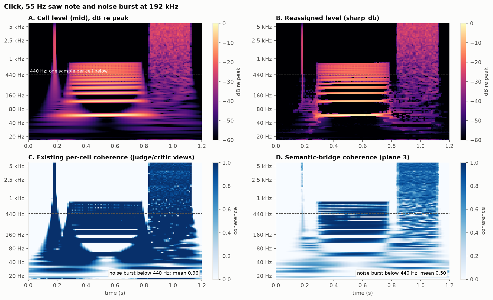
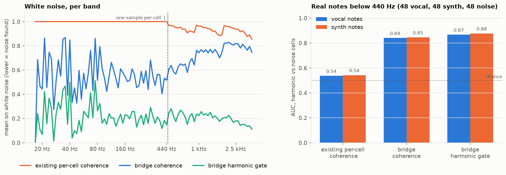
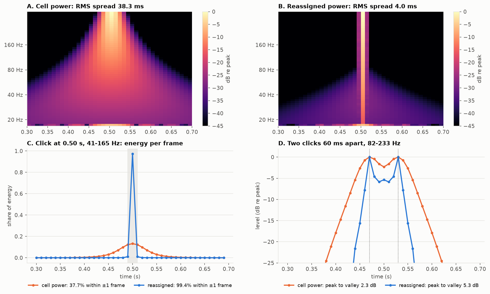
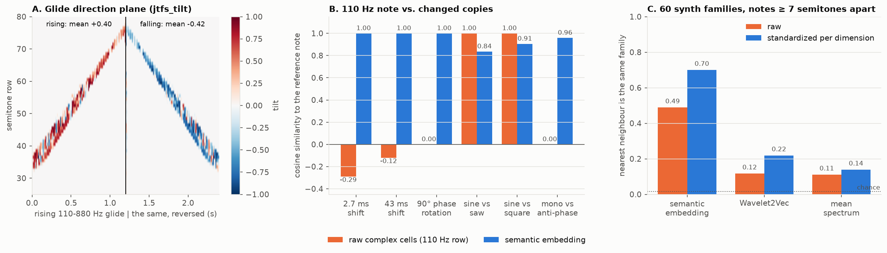

# Semantic bridge: analysis planes and an embedding on the lossless wavelet image

`wavelet2vec.semantic_bridge` computes differentiable analysis features from a
[WaveletImage](WAVELET_IMAGE.md) (192 kHz stereo, 149 semitone rows, 10 ms frames):
- a reassigned (sharpened) level;
- per-cell tonality that also works below 440 Hz;
- stereo correlation and glide direction;
- a 252-dimensional embedding of a clip.

The WaveletImage itself stays the exact, invertible carrier. These features are for judges, critics, losses,
retrieval and editor overlays.

Added on 17–18 October 2026 (written with Gemini). Reviewed, measured on real notes, and corrected on
25 October 2026; see [Changes after review](#changes-after-review-25-october-2026).

Code:
- [src/wavelet2vec/semantic_bridge.py](../src/wavelet2vec/semantic_bridge.py)
- tests: [tests/test_semantic_bridge.py](../tests/test_semantic_bridge.py)
- experiments: [experiments/semantic_bridge_experiments.py](../experiments/semantic_bridge_experiments.py), with results in
  [semantic_bridge_results.json](../experiments/semantic_bridge_results.json)
- figures: [experiments/plot_semantic_bridge_figures.py](../experiments/plot_semantic_bridge_figures.py)



*A click (0.18 s), a 55 Hz saw note (0.28–0.78 s) and a noise burst (0.84–1.12 s). A/B: the cell level,
and the reassigned level, where the click and the partials are sharp. C: the per-cell coherence of the existing
judge/critic views is 1.0 in every loud cell below 440 Hz (dashed line), noise included. D: the bridge's
coherence is low in the noise burst at all frequencies.*

## The problem below 440 Hz: one sample per cell

Each band of the WaveletImage keeps as many complex samples per 10 ms frame as its bandwidth needs:

| Samples per cell (c) | 1 | 2 | 4 | 8 | 16 | 32 | 64 | 128 | 256 |
|---|---|---|---|---|---|---|---|---|---|
| Rows | 58 (16–440 Hz) | 12 | 12 | 13 | 12 | 12 | 12 | 12 | 6 |

The existing views (`judge_view` in `morph.py`, `critic_view` in `morph_large.py`) describe each cell by:
- its mean power;
- the phase-step coherence u: the power-weighted mean phase step, as a vector whose length says how consistent
  the steps are;
- its modulation depth (std / mean of the sample powers).

These statistics are taken over the c samples of the cell. With c = 1:
- |u| = 1 and the modulation depth is 0 in every loud cell, whatever the signal (white noise included);
- the direction of u (the phase step from the previous frame) still varies from frame to frame, so CNN judges
  see some tonality cue in neighbouring cells, but the explicit coherence and modulation planes carry nothing
  there.

**Effect on MorphNet-L.** Its renderer splits each cell into a harmonic path (both notes' magnitudes on the
pitch source's phase) and a noise path (both notes with their own phases). The split uses a noise share m,
from that coherence:

    m = clamp((0.75 − coherence) / (0.75 − 0.40), 0, 1)

Below 440 Hz the coherence is always 1, so m = 0: every cell takes the harmonic path. Those cells still carry
the pitch source's own phase, so noise there is not made tonal. But the other note's noise is re-phased to the
source instead of being kept as it is.

*(An earlier version of this page quoted a different gate, `sigmoid(8·(coh − 0.55) − 3·mod)` = 0.9734, with
figures built on it. That formula is not in the code.)*

## How the bridge measures tonality

`reassigned_primitives` computes two extra signals per band, by multiplying the band's spectrum and
transforming back exactly (FFT per sample-count group):
- **s1**, the time derivative of the band signal s0;
- **s2**, the derivative with respect to the band's centre frequency (the Gaussian window's slope).

From them, per cell:

| Quantity | Formula | Steady sinusoid | Noise |
|---|---|---|---|
| amplitude-modulation rate | \|Re(s1 s0\*)\| / (2πσ\|s0\|²) | 0 | order 1 in every band |
| group-delay dispersion | 2πσ \|Im(s2 s0\*)\| / \|s0\|² | 0 | order 1 in every band |
| instantaneous frequency | Im(s1 s0\*) / (2π\|s0\|²) | the partial's frequency | random |
| group delay (time offset) | Im(s2 s0\*) / (2π\|s0\|²) | 0 | random |

σ is the band's Gaussian width in Hz. Normalizing by it makes the first two quantities comparable across
bands.

**Coherence:** the phase-step coherence, pooled over neighbouring frames where c < 5, multiplied by
exp(−0.85 · (am² + gd²)). Before multiplying, am and gd are smoothed over about one ring time of the band
(1–12 frames).
- Pooling the phase steps alone barely helps: harmonic-vs-noise AUC is 0.54–0.69 on real notes below 440 Hz.
  Narrowband noise looks steady over 50 ms.
- The modulation-rate and group-delay terms carry the separation.

**Reassigned level:** each cell's mid power moves to its instantaneous pitch and its group-delay time, scaled
by how well neighbouring bands agree, then splats bilinearly onto the grid.
- Total energy is kept exactly.
- Gradients reach the power and the coordinates.
- It is the differentiable counterpart of `detail_view(mode="sharp")`.

## API

| Function | Output |
|---|---|
| `reassigned_primitives(image)` | `ReassignedPrimitives`: per row and frame, mid/side/L/R power, instantaneous frequency, pitch offset, group delay, coherence, phase-step direction, modulation depth, cross-band agreements, AM rate, group-delay dispersion, reassigned mid power |
| `semantic_planes(image)` | `[B, 12, 149, 120]` planes, below |
| `harmonic_noise_gate(image)` | `[B, 149, T]`: 1 = tonal, 0 = noise; meaningful in active cells |
| `semantic_wavelet_embedding(audio_or_image, standardizer=None)` | `[B, 252]`, unit length |
| `fit_embedding_standardizer(embeddings)` | per-dimension mean and spread for `standardizer` |
| `jtfs_modulation_spectrum(planes)` | `[B, 84]` spectro-temporal modulation energy per register |
| `semantic_structure_loss(pred, target)` | differentiable distance of planes and modulation spectra |

**Levels** are relative to the clip's loudest cell (mid + side). The reference never drops below −40 dB re
full scale (a full-scale sine's cells peak near 0 dB). Digital silence and very quiet clips therefore sit at
the floor.

| Plane | Name | Range | Meaning |
|---|---|---|---|
| 0 | `mid_db` | [−1, 1] | mid level re the reference, floor −60 dB |
| 1 | `side_rel_db` | [−1, 1] | side-to-mid ratio (gated by mid + side level) |
| 2 | `sharp_db` | [−1, 1] | reassigned mid level |
| 3 | `phase_coherence` | [0, 1] | tonality, as above |
| 4, 5 | `vel_cos`, `vel_sin` | [−1, 1] | demodulated phase-step direction, weighted by tonality |
| 6 | `group_delay` | [−1, 1] | tanh(group delay / 3 frames) |
| 7 | `harmonic_agreement` | [0, 1] | neighbouring bands agree on the instantaneous pitch |
| 8 | `transient_agreement` | [0, 1] | neighbouring bands agree on the event time |
| 9 | `mod_depth` | [0, 1] | modulation depth, including the AM rate / group-delay terms |
| 10 | `jtfs_tilt` | [−1, 1] | glide direction: + rising, − falling |
| 11 | `stereo_corr` | [−1, 1] | L/R correlation: +1 mono, −1 anti-phase (gated by mid + side level) |

Each plane fades to its floor value between −48 and −60 dB:
- planes 3–7 and 9 with the mid level;
- planes 8 and 10 with the reassigned level;
- planes 1 and 11 with the mid + side level.

**Embedding:**
- 168 dimensions: the mean and spread of the 12 planes in 7 registers;
- 84 dimensions: modulation energy (3 rates × 2 spectral scales × 2 directions, per register).

## Measured

### Synthetic signals (experiments 1–5)

| Experiment | Existing views / raw | Bridge |
|---|---|---|
| 1. White noise below 440 Hz: coherence (110 Hz tone: 1.00 in both) | 1.00 | 0.55 |
| 1. White noise below 440 Hz: modulation depth | 0.00 | 0.90 |
| 1. MorphNet-L tonal share (1 − m) on that noise, `"cell"` vs `"scale"` | 1.00 | 0.55 |
| 2. Bass click (41–165 Hz): energy within ±1 frame | 37.7 % | 99.4 % |
| 2. Bass click: RMS spread | 38.3 ms | 4.0 ms |
| 2. Two clicks 60 ms apart (82–233 Hz): peak to valley | 2.3 dB | 5.3 dB |
| 3. Rising vs falling 110–880 Hz glide: cosine distance of the time-averaged spectrum / modulation spectrum / full embedding | 0.000001 | 0.17 / 0.008 |
| 3. Glide direction plane, mean (rising / falling) | — | +0.40 / −0.42 |
| 4. Same note shifted 2.7 ms / 43 ms / rotated 90°: cosine of raw cells vs embedding | −0.29 / −0.12 / 0.00 | 1.00 / 1.00 / 1.00 |
| 4. Sine vs saw / sine vs square, 110 Hz: cosine (raw cells of the fundamental's row are identical) | 1.00 / 1.00 | 0.84 / 0.91 |
| 4. Mono vs anti-phase stereo: cosine | 0.00 (no mid) | 0.96 |
| 5. 25 Adam steps on a waveform with `semantic_structure_loss` | — | loss −12.9 %, embedding cosine to target 0.33 → 0.44 |

The invariance in experiment 4 comes from pooling over time on a steady note. The full embedding hardly
separates rising from falling glides (0.008); its modulation-spectrum part does (0.17).





### Real notes (experiment 6)

Notes from note_dataset (MIDI 36–64; the prepared 192 kHz store of `experiments/train_morph.py`). Noise
notes: the note-shaped bursts the morph judges train against (white, pink, brown, band-pass, clicks).

**a. Harmonic vs noise cells below 440 Hz.**
- Harmonic cells: loud cells (within 30 dB of the peak) on a row of one of the first 11 partials. 48 vocal and
  48 synth notes.
- Noise cells: loud cells of 48 noise notes.
- AUC: the chance that a random harmonic cell scores above a random noise cell.

| Score | AUC vocal | AUC synth | Mean, harmonic cells (vocal / synth) | Mean, noise cells |
|---|---|---|---|---|
| existing per-cell coherence | 0.54 | 0.54 | 1.00 / 1.00 | 0.97 |
| bridge coherence | 0.84 | 0.85 | 0.84 / 0.85 | 0.51 |
| bridge harmonic gate | 0.87 | 0.88 | 0.75 / 0.74 | 0.18 |

**b. MorphNet-L noise path below 440 Hz** (share of cells with m > 0.5):

| Gate | Harmonic cells, vocal | Harmonic cells, synth | Noise cells |
|---|---|---|---|
| `"cell"` (as trained) | 0 % | 0 % | 3 % |
| `"scale"` | 16 % | 15 % | 52 % |
| `"scale"` + pitch protection (the notes' harmonic rows stay tonal) | 0 % | 0 % | 49 % |

Without protection, about 1 in 6 harmonic cells would lose its stable phase. That is the pitch wobble the
stable-pitch renderer was built to remove, so `"scale"` should be used with the notes' keys.

**c. Embeddings.**
- 360 synth notes from 60 families (6 per family, spread over the keyboard) and 120 vocal notes.
- Family: is the nearest other note at least 7 semitones away from the same family? Cosine; chance 0.017.
- Vocal vs synth: balanced accuracy of a 5-fold cross-validated logistic regression.

| Embedding | Dims | Family | Family, standardized | Vocal vs synth |
|---|---|---|---|---|
| semantic embedding | 252 | 0.49 | **0.70** | 0.98 |
| Wavelet2Vec | 570 | 0.12 | 0.22 | 0.98 |
| mean spectrum | 120 | 0.11 | 0.14 | 0.88 |

Standardizing matters for the semantic embedding: raw, most of the vector records which cells are empty. In
the test, the standardizer was fitted on the same 480 notes; fit it on reference data for real use.



## Using it in the models (opt-in)

The defaults are unchanged. Every trained judge, critic, cache, the diffusion run and MorphNet-L use the
existing statistics.

- **Views:** `judge_view(image, stats="scale")` and `critic_view(image, stats="scale")`. In the 58 one-sample
  rows, these take the coherence length and modulation depth from the bridge; the phase-step direction stays.
  - Other rows are identical.
  - The judge view stays an exact slice of the critic view.
  - New judges, critics and caches are needed. A judge must be fed the statistics it was trained on.
- **MorphNet-L:** `MorphNetL(..., noise_gate="scale")`, and pass `midis` to `decode`.
  - The one-sample rows use the bridge coherence; the rows of the notes' harmonics stay tonal.
  - Training: `experiments/train_morph_large.py --noise-gate scale`. Checkpoints record the choice;
    older checkpoints load as `"cell"`.
- **Embedding:** fit once with `fit_embedding_standardizer(semantic_wavelet_embedding(reference_audio))`, save
  it, and pass it as `standardizer=`.

## Changes after review (25 October 2026)

- **Silence and anti-phase fixed.** Levels were relative to the clip's own peak with no floor, so digital
  silence (and the empty mid channel of anti-phase stereo) read as full scale in every cell. Now:
  - the reference is the mid + side peak, never below −40 dB re full scale;
  - the stereo planes are gated by the mid + side level.
  The earlier "mono vs anti-phase −0.19" result came from this bug.
- **Tonality smoothing per band.** It now covers about one ring time of each band (1–12 frames) instead of a
  fixed 5 frames. Below 440 Hz the coherence AUC rose from 0.79 to 0.84, and the gate's from 0.85 to 0.87.
- AM rate and group-delay dispersion are exposed in `ReassignedPrimitives`.
- `fit_embedding_standardizer` and the `standardizer` argument were added.
- The opt-in view statistics and the MorphNet-L gate were added, with pitch protection.
- **Experiments corrected:**
  - MorphNet-L's real gate replaces the invented one;
  - every raw-cell value is computed (the earlier figure showed 0.52 / 0.61 for sine vs saw/square; the
    computed value is 1.00);
  - experiment 6 (real notes) was added.
- Figures are regenerated from the results file.
- This page was rewritten. Removed claims include:
  - "theorem", "proof", "bit-accurate" and "166,100× higher";
  - a clean tone/noise split stated from a sine against white noise;
  - "timbre-discriminative" without a real-data test.

## Limits

- **Tonality is not exact:** AUC is about 0.85 on real notes below 440 Hz. The gate's threshold was set on
  synthetic signals.
- **Not yet tested in training.** No model has been trained with the `"scale"` views or gate yet.
- **The structure loss** has only a 25-step synthetic check.
- **Levels are gain-invariant above −40 dBFS.** A quiet clip and a loud clip of the same sound look the same.
- **The embedding's invariances come from pooling over time.** It does not separate rising from falling
  glides well.

## Reproduce

```bash
pytest tests/test_semantic_bridge.py
python experiments/semantic_bridge_experiments.py          # add --skip-real without note_dataset
python experiments/plot_semantic_bridge_figures.py
```
