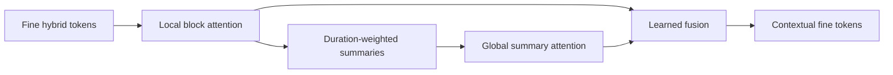
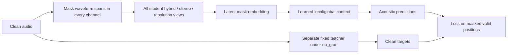

**Initial learned context and masked music pretraining — v0.29.0, 15 September 2026**

**v0.30.0 update:** [Optional target calibration](TARGET_CALIBRATION.md) adds
frozen training-only statistics and a matched three-seed comparison. The raw
objective below remains the default. Calibration shows a modest, inconsistent
toy benefit and is not a validated music recipe.

The library now has a learned temporal context backbone and a complete initial
masked-acoustic training path. These address the main architectural gaps from
the wav2vec comparison: tokens can exchange information across local blocks,
and a student can learn to predict clean acoustic targets from corrupted
audio without source-stem labels or pretrained teacher weights.

The initial implementation's tests and experiment provenance are recorded in
[SSL_VALIDATION.md](benchmarks/SSL_VALIDATION.md).

This is a research implementation with fixed acoustic targets, not a trained
music foundation model. The first synthetic experiment reduced loss but did
not beat a constant-target baseline on held-out clips. Musical semantics,
instrument identity, harmony/structure transfer and separation gains remain
to be established on appropriate music data.

**Context is learned at two temporal scales.** `MusicContextEncoder` applies
Transformer layers independently within token blocks. It duration-pools their
learned states, applies another Transformer across those summaries, and fuses
the global result back into the fine states. A distant block can therefore
affect a fine output token while its pre-global local state stays unchanged;
the regression suite tests this relationship.



The model uses bidirectional context; it is not a causal/live-streaming model.
Position features are sinusoidal functions of physical seconds relative to
each sequence's first real token. Global input timestamps remain in the output
metadata. The default period range is 40 ms–600 s and is configurable; those
defaults are not an empirically established musical optimum.

`MusicContextConfig` specifies width, heads, local/global depth, block size,
dropout, positional periods and limits. Local attention costs scale with block
size, while global attention is quadratic in the number of summaries. Guards
limit summary count and estimated attention elements before attention layers
run. They are not total RAM/VRAM guarantees. Whole sequences and training
activations still occupy memory; this does not supply unlimited context.

**Use cached/sliding local features with the context model.**

```python
import torch
from wavelet2vec import MusicContextConfig, MusicContextEncoder

context = MusicContextEncoder(MusicContextConfig(
    dim=32, heads=4, local_layers=1, global_layers=1,
    local_tokens=8, dropout=0.0,
))
tokens = torch.randn(2, 24, 32)
times = torch.arange(24, dtype=torch.float64) * 0.01
valid = torch.arange(24)[None] < torch.tensor([24, 13])[:, None]
result = context(tokens, times_s=times, valid_mask=valid,
                 return_hidden_states=True)
print(result.tokens.shape)         # [2, 24, 32]
print(result.coarse_tokens.shape)  # [2, 3, 32]
```

`valid_samples` optionally supplies duration weights, using `[T]` or `[B,T]`
metadata. Padding may contain invalid placeholders; real tokens/times must be
finite and times must increase. Empty local blocks are excluded from local
attention, and each sequence needs at least one real token. Padded fine/coarse
outputs are zeroed. `return_hidden_states=True` exposes the local layers as
fine sequences and the global layers as coarse sequences for later probes.

For long recordings, first use the existing `SlidingHybridEncoder` or load
its cached `HybridSequence`, then call the trained context model on its tokens,
times and durations. Do not put the context model inside an independent sliding
window and assume it then exchanges information between those windows. The
context API processes the supplied sequence as a whole within its budget.

**Masked prediction has an explicit clean/student boundary.**



`MaskedMusicModel` accepts `AudioBatch`, not precomputed clean carriers or
cached clean features. It zeroes masked sample spans across every channel
**before** invoking any student front end. Every student stereo and spectral
view therefore derives from the same corrupted audio. It also replaces
masked local tokens with a learned mask embedding before contextualization.
Student predictions and context outputs do not expose an original clean
carrier. The clean teacher is called separately and its targets are detached.

Tests change only the hidden clean samples and require identical student
predictions, while clean targets change. They also require zero gradients from
the loss into those hidden input samples. These checks cover dense wavelets,
compact wavelets, STFT, and combined multi-resolution/stereo students. They
validate the implemented data path, not arbitrary custom modules that read
external state or a different user-written training loop.

**The first teacher is deliberately fixed and continuous.** It uses a
`HybridAudioFrontend` and returns signed demodulated real/imaginary features
and log-RMS features, grouped by channel and band. The default teacher copies
the primary student's analysis configuration with complex context enabled;
a separate config may be supplied if its sample rate and token hop match.
It has no trained codebook or learned parameters. Targets are acoustic
descriptors, not verified semantic labels for notes, instruments or phrases.

The objective is masked smooth-L1 prediction with separate log-magnitude and
phase-feature weights (defaults 1.0 and 0.1). Real sample counts weight partial
patches. Input clips are analyzed at their actual lengths so padded batch tails
do not affect targets or student features. Teacher supervision can be lossy;
the original invertible carrier APIs remain available separately for synthesis.
This semantic training output is not advertised as lossless audio encoding.

Fixed targets cannot jointly collapse with the student like a jointly learned
target system can, but the student can still learn a weak constant predictor.
The model reports target/prediction standard deviation, masked token fraction
and masked sample count. These are diagnostics, not proof that useful features
were learned. Future learned teacher/quantizer variants need appropriate
anti-collapse mechanisms and comparisons, rather than assuming this objective
is the final choice for music.

**Construct an unlabeled batch and train.**

```python
from wavelet2vec import (
    HybridConfig, HybridTokenEncoder, MaskedMusicModel,
    MaskedPredictionConfig, collate_audio,
    MusicPretrainer, PretrainingConfig,
)

analysis = HybridConfig(sample_rate=44100, backend="compact_wavelet",
                        n_bands=32, q=4, hop_length=256)
local = HybridTokenEncoder(analysis, channels=2, dim=32)
model = MaskedMusicModel(
    local,
    context_config=MusicContextConfig(dim=32, heads=4, local_layers=1,
                                      global_layers=1, local_tokens=8, dropout=0.0),
    prediction_config=MaskedPredictionConfig(mask_fraction=0.5, span_tokens=4),
)
# Small synthetic shapes for this API example; not a musical training corpus.
batch = collate_audio([torch.randn(2, 4410)*0.1, torch.randn(2, 6615)*0.1],
                       sample_rate=44100, sample_origins=[0, 44100])
trainer = MusicPretrainer(model, PretrainingConfig(
    learning_rate=0.001, warmup_steps=1, total_steps=5, mask_seed=7,
))
metrics = trainer.step(batch)
print(metrics["loss"], metrics["prediction_std"], metrics["target_std"])
```

`collate_audio` pads variable-length `[C,N]` clips, preserves dtype/channel
order and records one global origin per clip. It does not resample or normalize
levels. All clips must already have the declared sample rate and common channel
count/precision/device. `AudioBatch.to(device)` moves metadata and samples
without changing precision. The masked wrapper analyzes clips individually;
it does not yet optimize variable-rate carrier batching across the whole batch.

`sample_span_mask` uses a seeded CPU generator and prefix-valid token masks.
It preserves visible context and never masks padding. The last span may be
shortened to meet the count. Too-short clips can have no masked positions; a
training batch with no masked targets is rejected. Mask size is in tokens:
physical duration is `span_tokens * hop_length / sample_rate`. Default spans
are engineering starting points; music experiments should compare longer and
structured spans to avoid rewarding local interpolation alone.

`encoder_options` on the masked model can select official local adapter
ablations, with reserved input/origin arguments rejected. Even secondary
carriers retained internally by an adapter are derived from corrupted student
audio. Explicit clean targets, original-waveform skip connections or old clean
feature caches must never be inserted into the prediction path.

**The training runner is resumable at update boundaries.** `MusicPretrainer`
provides AdamW, warmup/cosine learning rates, gradient accumulation, clipping
and finite-loss/gradient checks. A failed batch discards pending accumulated
gradients so they cannot contaminate the next update; RNG/caller data position
is not transactionally rolled back. Accumulation averages microbatch losses,
so unequal microbatch sample counts are not identical to one large weighted
batch. `LengthBucketSampler` produces seeded batches of similar clip lengths
and supports `set_epoch`; it does not load audio or implement distributed
sampling.

```python
trainer.save_checkpoint("masked-music.pt", data_state={"next_batch": 1})
restored_model = MaskedMusicModel(
    HybridTokenEncoder(analysis, channels=2, dim=32),
    context_config=model.context.config,
    prediction_config=model.config,
)
restored = MusicPretrainer(restored_model, trainer.config)
cursor = restored.load_checkpoint("masked-music.pt")
assert cursor["next_batch"] == 1
```

Checkpoints store model/optimizer state, configuration, update counters,
mask-generator and torch CPU/CUDA RNG states, and caller-supplied JSON data
state. Saves reject pending accumulation because gradients are not serialized.
Loads check configurations and available package/dependency code identity
before changing weights. Tests reproduce the next mask, dropout-dependent
loss and parameter update exactly on the tested setup when supplied the same
next batch. Caller-owned dataset/crop cursors must be restored separately.

Changing software/hardware, custom external module code or data order can
break exact reproducibility. CUDA RNG restore requires matching device count;
for an intentional migration load model weights separately. External custom
module revisions should be recorded in the run's data/provenance state. AMP,
distributed optimization, automatic real-music decoding and large-corpus
performance tuning are not part of this first runner.

**The initial learning experiment has a useful negative result.**

```powershell
& C:\Users\vikto\an3\envs\sound\python.exe -m experiments.masked_music_demo --steps 80
```

The fixed-seed experiment uses 24 synthetic harmonic textures for training
and eight independently generated clips for validation, at 8.192 kHz. It
computes a constant-target baseline from training teacher features only.
The validation mask is held fixed; no pretrained model or external data is used.

| Measurement | Result |
| --- | --- |
| Initial held-out masked objective | 0.025142 |
| After 80 optimizer steps | 0.001872 |
| Training-mean constant-target baseline | 0.001800 |

Results and seeds: [masked_music_demo.json](benchmarks/masked_music_demo.json).
Optimization reduced the objective by about 13x, but the model did **not**
beat the constant baseline. That is evidence that loss reduction alone is
insufficient, not a successful semantic benchmark. Target design, scale,
mask duration and realistic music data need further study. Do not infer
instrument separation, musical understanding or superiority over wav2vec/MERT
from this smoke experiment or the numerical test suite.

**Research basis and remaining gaps.** Hierarchical attention and masked
prediction are established ideas. [wav2vec 2.0](https://arxiv.org/abs/2006.11477)
uses masked contrastive learning with quantized targets;
[MERT](https://arxiv.org/abs/2306.00107) provides a music-focused example of
teacher-driven masked learning. This implementation uses a simpler continuous
fixed teacher and makes no novelty claim. The most important remaining work
is a real-music data/evaluation recipe, stronger target choices, and evidence
that context helps beyond constant/local baselines. Learned quantization and
semantic/aspect heads remain candidates, not prerequisites or completed work.
