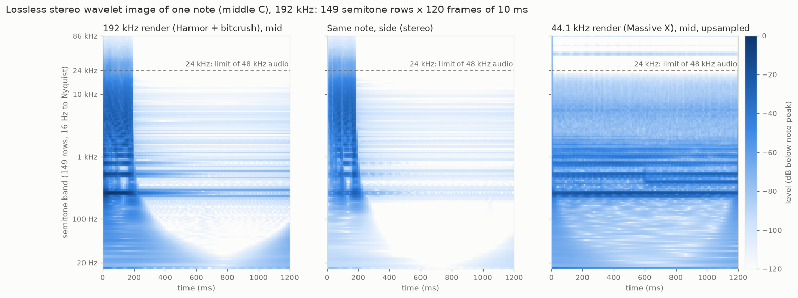

# Lossless stereo wavelet image (192 kHz)

8 October 2026. The representation for the next KeyboardNet experiment (v3):
audio becomes an image and comes back with **no loss beyond float32
precision**, at 192 kHz, in stereo.

*Middle C from three sources, as the cell levels of the wavelet image. Left
and middle: a 192 kHz Harmor render with bitcrush distortion, mid and side
channels. Its distortion reaches 86 kHz, above the dashed 24 kHz limit of
48 kHz audio. Right: a 44.1 kHz render, upsampled, empty above about 22 kHz.
The lowest rows are smeared in time (the curve below 100 Hz): that is the
constant-Q trade-off, not a loss; it inverts exactly.*

## Why a new representation

KeyboardNet v2 read seven pooled summaries per semitone band per 10 ms,
computed at 48 kHz. That summary is lossy:
- nothing above 20 kHz;
- no exact phase;
- stereo reduced to one width number per band.

Its output was rebuilt by reshaping a carrier, which lost part of the
prediction. The library already had exact transforms:
- the dense constant-Q frame: round trip ~305 dB; float32 TIFF ≈ 160 dB,
  16-bit PNG ≈ 84 dB ([FINDINGS](FINDINGS.md));
- the compact multirate bank ([COMPACT_WAVELETS](COMPACT_WAVELETS.md)).

But the dense frame stores every band at the full sample rate: at 192 kHz,
about 150 × 230,400 complex values per channel for one 1.2 s note. The
compact bank stores each band at its own rate, so it is not an image.

## What it is

[src/wavelet2vec/wavelet_image.py](../src/wavelet2vec/wavelet_image.py) lays
the compact bank out as an image:

| | |
|---|---|
| Rows | **149 semitone bands**, MIDI 12–160 (16.35 Hz – 84 kHz centres). The first band extends to DC and the last to Nyquist (96 kHz): the whole spectrum is covered |
| Columns | **10 ms frames**: 120 for a 1.2 s note, plus 8 frames of zero context on each side |
| Cell | **every complex sample of that band in that 10 ms**: 1 for the lowest 58 bands, then doubling per octave up to 256 in the top band |
| Channels | **mid and side** ((L+R)/2, (L−R)/2): an exact change of basis, so stereo width and phase are kept |
| Bands | Gaussian, 0.6 of a semitone wide (σ), cut at ±3σ, rounded outward to whole FFT bins |
| Inverse | window-weighted sum over bands divided by the squared-window coverage (min/max 0.87: well conditioned) |

Each band keeps at least as many samples as its frequency support, so
nothing aliases. Its sample count is a whole number per frame, rounded up to
a power of two, so sample *j* of band *b* lies in frame *j / c_b*. Rounding
to powers of two makes **each upper octave one group** of 12 bands with the
same cell size (9 groups in total). A model can therefore embed each group
with its own projection and write coefficients back the same way: both its
input and its output are the complete signal.

Size: 1.26 million real values per channel per note, **4.8× the samples**
(the price of overlapping, invertible bands). That is 10 MB per stereo note
as float32 TIFF files.

## Measured round trips (real dataset notes, middle C, 192 kHz)

| Note | float64 L / R / side | float32 L / R / side | float32 TIFF on disk |
|---|---|---|---|
| 192 kHz Harmor + bitcrush (content above 24 kHz: −53 dB) | 306 / 306 / 306 dB | 132 / 132 / 130 dB | identical to in-memory |
| 192 kHz Serum, wide stereo (side as loud as mid) | 303 / 307 / 306 dB | 129 / 133 / 132 dB | identical |
| 44.1 kHz Massive X, upsampled ×640/147 | 302 / 307 / 306 dB | 128 / 134 / 132 dB | identical |
| 96 kHz Korg recording, upsampled ×2 (mono source) | 305 / 305 dB, side exactly 0 | 132 / 132 dB | identical |
| 96 kHz own voice, upsampled ×2 (mono source) | 306 / 306 dB, side exactly 0 | 132 / 132 dB | identical |

- **float64 is exact** at the 1e-15 level.
- **float32 storage** reaches ~130 dB: the precision limit of float32. That
  is beyond what real 24-bit converters achieve (~120 dB), though below
  24-bit's theoretical 144 dB. Storing the images as float64 keeps the
  ~305 dB.
- **Speed:** encoding plus decoding takes 0.02–0.04 s per stereo note on the
  CPU.
- **Settings tried:** 1.0σ/4σ cost 7.4× the samples (coverage 0.55); the
  chosen 0.6σ/3σ costs 4.8× (0.87), with the same precision.

Tests: [tests/test_wavelet_image.py](../tests/test_wavelet_image.py):
- float64 and float32 stereo round trips;
- a click lands in its own 10 ms column, an A4 tone in the A4 row;
- TIFF files invert back to audio.

## Data for v3

[experiments/keyboard_v3_dataset.py](../experiments/keyboard_v3_dataset.py)
stores every usable note (the v1/v2 selection and exclusions) as exact
stereo float32 audio at 192 kHz:
- 1.8 MB per note, one array per source file;
- `index.json` records each note's MIDI number, family, source type,
  envelope class and **source sample rate**.

Rates are converted explicitly (44.1 kHz ×640/147, 96 kHz ×2). Above a
source's own Nyquist, the image rows are empty by construction: a model must
neither be scored there nor taught that such sounds have no highs.

**Upsampling leaves faint images above the source Nyquist.** Polyphase
conversion to 192 kHz leaves mirror copies of strong low content:
- around 44.1 kHz for 44.1 kHz sources (the Kontakt piano example: up to
  −73 dB below the note's peak, rows near 42–44 kHz);
- near 96 kHz for 96 kHz sources (−89 dB).

These rows are never scored, but the model sees them in its input. A
stronger anti-imaging filter, or zeroing rows above each source's Nyquist,
would remove them in the next data build.

**Dashboard view:** `python experiments/encoding_examples.py` writes
`encoding_examples.json` and the three notes' audio into the v3 run folder.
The training dashboard then shows three unrelated notes at three source
resolutions: a 192 kHz synth, your 96 kHz voice and a 44.1 kHz piano. For
each, it draws:
- the waveform and the multirate cell layout;
- the mid and side wavelet image and the exact key change;
- the stereo image (see below);
- the per-cell feature planes;
- the measured round trips.

It also has a zoomable detail viewer. Every picture is hoverable.

## Pictures at screen resolution

The first dashboard maps looked pixelated because they showed one RMS value
per 10 ms × semitone cell: 149 × 120 values, enlarged. That is the
backbone's grid, not the image's resolution. The upper rows store up to 256
complex samples per cell, with exact phase.

`detail_view` and `stereo_view` draw from every sample, at any size and
zoom. The dashboard requests each picture at the canvas's own pixel count.
There are three pictures:

| Picture | What it shows |
|---|---|
| **Exact samples** | Each band's level at its own time resolution (band-limited interpolation of its samples), blended between band centres. The honest look of the bank itself: the bass is smooth in time (a 100 Hz band spans ~45 ms), the top is sharp to ~0.1 ms. |
| **Sharp (reassigned)** | Each sample's energy moves to its instantaneous frequency (exact phase derivative) and to its group delay (from the derivative of its band's Gaussian window). Both are computed in the band's own spectrum, from the cells alone. |
| **Cell grid** | The backbone's 10 ms × semitone grid, for comparison. |

**How the sharp picture decides what to move:** a move is trusted only as
far as neighbouring bands agree on it. Plain reassignment piles noise up at
every band centre: one stripe per semitone, as seen in the piano. With the
agreement rule:
- a resolved partial is placed at the same pitch by its neighbours, so it
  becomes a line;
- noise and unresolved mixtures are spread smoothly over their band;
- attacks and clicks agree in time, so they become edges.

A 0.7-pixel blur of the power keeps one-pixel lines visible when shrunk.

Measured on test signals:

| Signal | Sharp | Cell grid | Exact samples |
|---|---|---|---|
| 1 kHz tone: energy within ±½ semitone | 99 % | 64 % | 76 % |
| Bass click (41–466 Hz): energy within ±3 ms | 99.9 % | – | 15 % |

The sharp picture also keeps the tone's level to within 0.5 dB.

**Stereo image:** each view also reads left = mid + side and
right = mid − side per sample, so stereo is drawn the same three ways:
- **balance:** where each partial sits between left and right;
- **phase correlation:** in phase, unrelated (wide) or opposite.

The dashboard adds, per note:
- a **goniometer** (every sample, side against mid);
- **correlation and balance per semitone row**.

The three examples differ clearly:

| Note | Correlation | Balance | Character |
|---|---|---|---|
| Serum pluck | −0.14 | right 0.49 | Wide: its expander makes the upper octaves partly opposite in phase |
| Your voice | +1.00 | centre | Mono |
| Kontakt piano A2 | +0.32 | left 0.75 | The low note sits left, as on a real piano |

Tests: [tests/test_wavelet_image.py](../tests/test_wavelet_image.py)
covers:
- the tone line and its level;
- the click back in place;
- noise without stripes;
- balance and correlation for left-only, right-only, mono and opposite-phase
  tones.

## How v3 will use it (plan)

- **Input:** the given notes' complete wavelet images, mid and side. Each
  octave group of cells goes through its own linear embedding into a common
  width, which gives a 149 × 120 grid (padded) for the backbone. Nothing is
  pooled away before the network.
- **Key change:** the carrier for the target key is built in the image
  domain. Each row moves by the interval, with the exact heterodyne phase
  ramp, and its cells are resampled to the destination row's cell size.
- **Output:** a complex correction per cell (gain and phase), applied to the
  carrier, plus an additive residual for content the carrier lacks. Each
  group is projected back to its exact cell size. Decoding is the exact
  inverse, so **the output is audio at 192 kHz with no renderer gap.**
- **Losses:**
  - cell log-magnitude (as v2's envelope loss);
  - a complex, phase-aware term;
  - a multi-resolution spectral loss on the decoded audio;

  all masked above each note's source Nyquist.
- **Backbone and head:** v2's evaluation found the 223M-parameter backbone
  underused on 13,006 notes. v3 should start with a smaller backbone; Swin-L
  remains an option once the data grows.
